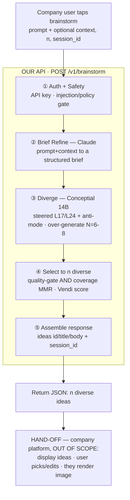

# Brainstorm API — Architecture (v1)

_Last updated: 2026-05-23 · See also `docs/brainstorm_api_buildout_plan.md`_

## What this is — and where it stops

One hosted endpoint a partner company calls when their end-user taps a
**"brainstorm"** button.

- **In:** a `prompt` (+ optional `context`).
- **Out:** **N diverse ideas** (`title` + `body`) the user can choose from or edit.

That is the entire job of the API.

> **Hard scope boundary — our responsibility ends the instant we return the
> ideas.** After that, the company's own platform displays them, lets their user
> pick or edit one, and generates any image. We don't build, host, or reason
> about any of that. This doc covers only what runs *inside* the API; the
> hand-off is intentionally a dead-end here.

## The pipeline



At a glance: `prompt → auth+safety → refine → diverge ×N → select →n → return`.

## What each step does

**① Auth + Safety.** Authenticate the company by API key (`Bearer`); reject
missing/invalid keys. Then run the user's `prompt`+`context` through the safety
gate (injection, oversized input, control bytes). Cheap, fast, fail-closed —
nothing reaches the model until this passes.

**② Brief refine (Claude).** A single Claude call turns a raw, often-vague user
prompt into a structured *brief* (objective, audience, hard constraints, output
format). The rule that matters: the brief is **enabling, not prescriptive** — it
sharpens *what* is being asked and pins *constraints*, but it must **not pick a
creative direction**. If refine pre-commits to an angle, it narrows the space
before Conceptial can diversify, which defeats the whole product. Any research
on `context` extracts *facts*, never ideas.

**③ Diverge — Conceptial (the core, the differentiator).** The steered 14B
(creative L17 / technical L24) generates candidates from the brief, with
prompt-level anti-mode and iterative orthogonalization pushing each generation
away from the others. We deliberately **over-generate** (~6–8) instead of asking
for exactly `n` — a larger pool is what lets the selector return a genuinely
distinct final set.

**④ Select → n diverse ideas.** From the pool, pick the `n` (default 3) that are
both *good* and *maximally different*: a quality gate (coherent, on-topic) **and**
diversity-coverage selection (greedy MMR over embeddings) so the returned ideas
span distinct concepts instead of clustering. Taking the "top n by score" would
clump; selecting for coverage is what makes the set feel distinct. We compute a
**Vendi diversity score** on the chosen set and return it — proof of value,
in-band.

**⑤ Assemble + return.** Parse each idea into `{id, title, body}`, mint a stable
`idea.id`, and attach a `session_id` (writing the chosen ideas to per-session
memory). The IDs + `session_id` exist so "edit this one" and "continue
brainstorming from here" can be added later **without changing the contract** —
we issue them now but build no further statefulness.

**Hand-off (terminal — not ours).** We return JSON. The company displays the
ideas, their user picks/edits, and they render an image on their platform.

## Response contract

```
POST /v1/brainstorm   (Authorization: Bearer <company_api_key>)

Request:  { "prompt": "...", "context": "...?", "n": 3, "session_id": "uuid?" }

Response: { "request_id", "session_id",
            "ideas": [ { "id", "title", "body" }, ... n ],
            "diversity": { "score": 0.82, "method": "vendi" },
            "model": "conceptial-14b" }

Errors:   400 prompt/safety · 401 bad key · 422 validation · 429 rate-limit
          · 503 engine unavailable (+ Retry-After)
```

## How diversity is kept and proven (inside the API)

Three mechanisms, all upstream of the hand-off:
1. **Generated diverse** — steering + anti-mode + iterative ortho at generation.
2. **Selected for spread** — MMR coverage over an over-generated pool, not top-n.
3. **Measured** — Vendi score on the returned set, surfaced in the payload.

The only internal threat to diversity is step ② over-narrowing the brief —
mitigated by the enabling-not-prescriptive rule, and checkable by A/B-ing
refine-on vs refine-off against the Vendi score.

## Deliberately NOT in the API (and why)

| Excluded | Why |
|---|---|
| Image generation | Happens on the company's platform — never ours |
| "Choose / edit an idea" UI | The company's product surface |
| Per-idea LLM clarity-rewrite | Skipped — it risks homogenizing the diversity, and `title`/`body` ideas don't need polishing |
| ΔDiversity before/after guardrail | Only needed if we post-process ideas with an LLM (we don't) |
| Feedback / DPO training loop | First-party-product roadmap, not this API |
| RAG / retrieval | Optional future hook; off in v1 |

## Module map (repo)

| Step | Module |
|---|---|
| Auth | `api/auth.py` (new) |
| Safety | `api/safety.py` |
| Refine | `refine.py` (new, Claude) |
| Diverge | `model/engine_adapter.py` → `conceptial/engine/`; `conceptial/anti_mode.py` |
| Select + score | `pipeline/select.py` (new) + `vendi-score` |
| Memory / session | `conceptial/idea_store.py` |
| Endpoint | `api/public.py` (new — separate GPU service, see buildout plan) |
| Steering config | `config/conceptial_14b.json` (L17 creative / L24 technical) |
