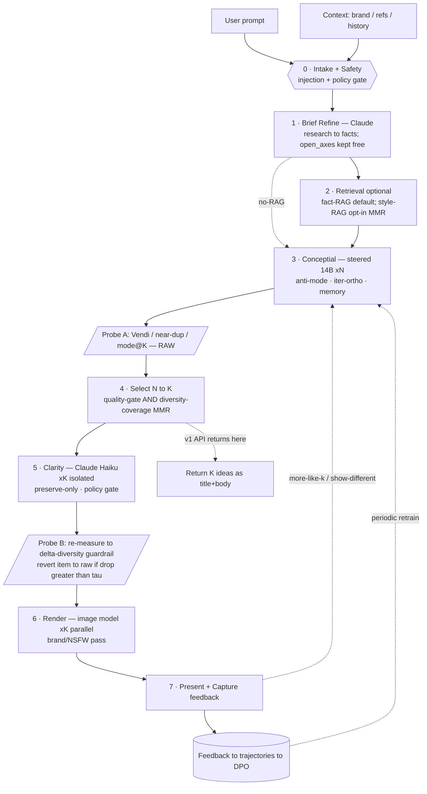

# Conceptial — Brainstorm Pipeline Architecture (north star)

_Last updated: 2026-05-23_

## Purpose

Reference for the end-to-end diverse-ideation pipeline. The governing
**invariant**: diversity is a *measured, guarded* property across every stage —
not a hope. Vanilla LLMs mode-collapse; Conceptial's entire value is distinct,
diverse ideas, so the pipeline must **preserve and prove** that diversity all
the way to the output.

> **Scope note.** The v1 product API (see `brainstorm_api_buildout_plan.md`)
> implements stages **0–4 only** and returns text ideas; the integrating
> company renders images on their side. Stages 5–7 are the fuller north star
> for the first-party product.

## Flow (ASCII)

```
┌─────────────┐     ┌─────────────────────────────┐
│ User prompt │     │ Context                     │  brand facts · refs ·
└──────┬──────┘     │ (define it)                 │  history · domain
       │            └──────────────┬──────────────┘
       └───────┬───────────────────┘
               ▼
        ╔══════════════════╗   GATE 1: injection + policy
        ║ 0 INTAKE + SAFETY ║   (api/safety.validate_user_prompt)
        ╚═════════╤════════╝
                  ▼
   ┌────────────────────────────────┐   CreativeBrief{objective, audience,
   │ 1 BRIEF REFINE  (Claude,strong) │──▶ hard_constraints, format_spec,
   │   research → FACTS, not ideas   │    OPEN_AXES[], n}
   └───────────────┬────────────────┘
                   │           ┌───────────────────────────────┐
                   ├──────────▶│ 2 RETRIEVAL (optional)        │ fact-RAG: on
                   │  facts    │   MMR/diverse · Docker=vectorDB│ style-RAG: opt-in
                   │◀──────────│   (Qdrant/Chroma)             │ ("diverge-from")
                   ▼
   ┌────────────────────────────────┐   SteeringEngine (L17 creative /
   │ 3 CONCEPTIAL  steered 14B  ×N   │   L24 technical) + anti_mode +
   │   ▲ project memory / anti-mode  │   iterative ortho + idea_store
   └───────────────┬────────────────┘
                   │  ◆ PROBE A — Vendi / near-dup / mode@K on RAW N  (ground truth)
                   ▼
   ┌────────────────────────────────┐   quality-gate ∧ diversity-coverage
   │ 4 SELECT   N → K                │   (greedy MMR / facility-location)
   └───────────────┬────────────────┘   ∧ brief-relevance        ← v1 API stops here
                   ▼
   ┌────────────────────────────────┐   per-concept ISOLATED · preserve-only
   │ 5 CLARITY  (Claude Haiku) ×K    │   GATE 2: policy-check each final prompt
   └───────────────┬────────────────┘
                   │  ◆ PROBE B — re-measure → ΔDIVERSITY GUARDRAIL
                   │     if drop > τ ⇒ revert that item to its raw concept
                   ▼
   ┌────────────────────────────────┐   fan-out ∥ · output brand/NSFW pass
   │ 6 RENDER  (image model)  ×K     │   (first-party product only)
   └───────────────┬────────────────┘
                   ▼
   ┌────────────────────────────────┐        ┌───────────────────────────┐
   │ 7 PRESENT + CAPTURE             │───────▶│ feedback/human →           │
   │   show K + live diversity story │  fb    │ trajectories → DPO         │
   └───────────────┬────────────────┘        │ (run_feedback_loop)        │
        │ "more like #k"  "show different"    └────────────┬──────────────┘
        └──────────────────────────────────────────────────┘ periodic retrain
              re-enter §3 with anchor  |  or anti-mode+memory excluding shown modes

  side rails ─────────────────────────────────────────────────────────────
  OBSERVABILITY: per-stage latency/cost + diversity(pre/post/Δ) per request
  CACHING: brief by hash(prompt+context) · render by hash(final_prompt)
  FALLBACK: Conceptial down ⇒ cached exemplars OR baseline w/ explicit degraded flag
```

## Flow (Mermaid)



## Stages

| # | Stage | Powered by | Notes |
|---|-------|-----------|-------|
| 0 | Intake + Safety | `api/safety.validate_user_prompt` | reject injection / oversized / control bytes |
| 1 | Brief refine | Claude (strong model) | prompt+context → structured brief; **enabling, not prescriptive** — `hard_constraints` vs `open_axes`; research extracts FACTS only |
| 2 | Retrieval (opt.) | vector DB (Docker) | fact-RAG default (grounding); style-RAG opt-in via **MMR** as "diverge-from", never templates |
| 3 | Conceptial | `EngineGenerator` (L17/L24 steered 14B) + `anti_mode` + iterative-ortho + `idea_store` | over-generate **N**; the diversity source |
| 4 | Select N→K | selector + `vendi-score` | quality-gate ∧ diversity-coverage (greedy MMR) ∧ brief-relevance |
| 5 | Clarity | Claude (Haiku) | **isolated per-concept**, preserve-only transform; policy-gate each output |
| 6 | Render | image model | fan-out parallel; brand/NSFW pass (first-party only) |
| 7 | Present + capture | `feedback/*`, `training/*` | surface metrics; capture ratings → DPO |

## Data contracts (versioned)

```
CreativeBrief  { objective, audience, hard_constraints[], format_spec,
                 open_axes[], n, brand_facts[]?, diverge_from[]? }
Concept        { id, text, raw_steering_meta{creative_layer, alpha, seed} }
ScoredConcept  { ...Concept, quality{coherence,on_topic}, selected:bool }
Idea           { id, title, body }                      ← v1 API output
ImagePrompt    { concept_id, prompt, policy_ok, reverted_to_raw }
RenderResult   { concept_id, prompt, image_uri, safety_ok }
DiversityReport{ pre{vendi,near_dup,mode_at_k}, post{...}, delta, flags[] }
```

`project_id` / `session_id` threads through to `idea_store` so memory + anti-mode
are per-project / per-session.

## ΔDiversity guardrail (the key mechanism)

Automated defense against the Claude clarity pass (stage 5) silently
re-collapsing what Conceptial diversified:

```
diversity_pre  = measure(selected K raw concepts)      # before stage 5
diversity_post = measure(K rewritten prompts)          # after stage 5
revert item i to its raw concept if:
    near_dup_post > near_dup_pre + 0.05      # ideas converging
 OR vendi_post   < 0.90 * vendi_pre          # spread shrinking
 OR cos(raw_i, rewrite_i) < 0.80             # concept identity drifted
alert if aggregate Δ breaches threshold (the stage is net-harmful)
```

Metrics already in-stack: Vendi (`vendi-score`), near-dup (cos ≥ 0.92,
`text-embedding-3-small`), mode-collapse@K (cos ≥ 0.85 clusters). Exercised by
`tests/test_diversity_metrics.py`.

## Feedback loop (the moat)

- **"more like #k"** → re-enter §3 with concept *k* as a positive anchor.
- **"show different"** → re-enter §3 with anti-mode + memory excluding shown modes.
- Ratings/edits → `feedback/human` → `trajectories` → preference pairs → DPO
  (`training/dpo`, `scripts/run_feedback_loop`) → periodic steering/model update.

## Module map (repo)

| Concern | Module |
|---|---|
| Safety gate | `src/brainstormlm/api/safety.py` |
| Local model (Conceptial) | `src/brainstormlm/model/engine_adapter.py` → `conceptial/engine/` |
| Diversity mechanisms | `conceptial/anti_mode.py`, iterative-ortho in `runpod_batch_14b.py` |
| Memory / sessions | `conceptial/idea_store.py` |
| Diversity metrics | `vendi-score` dep; `tests/test_diversity_metrics.py` |
| Feedback / training | `feedback/*`, `training/*`, `scripts/run_feedback_loop.py` |
| Steering config | `config/conceptial_14b.json` (L17 creative / L24 technical) |
